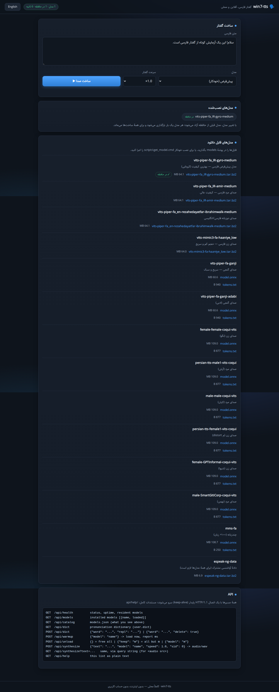
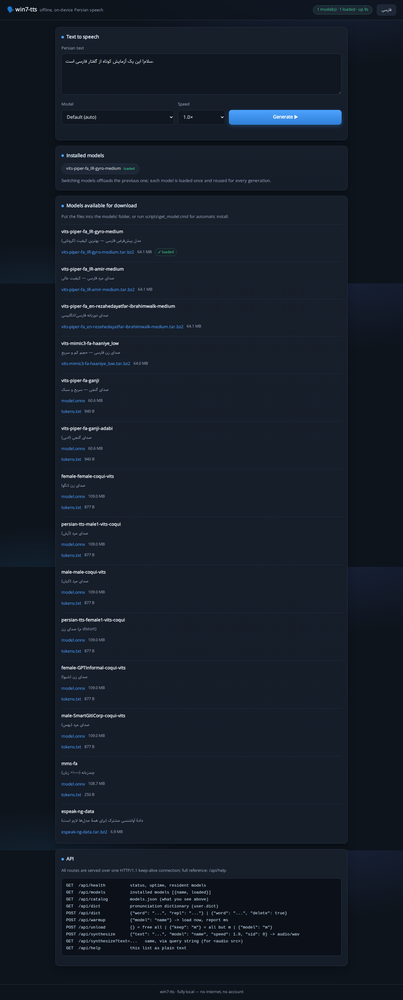
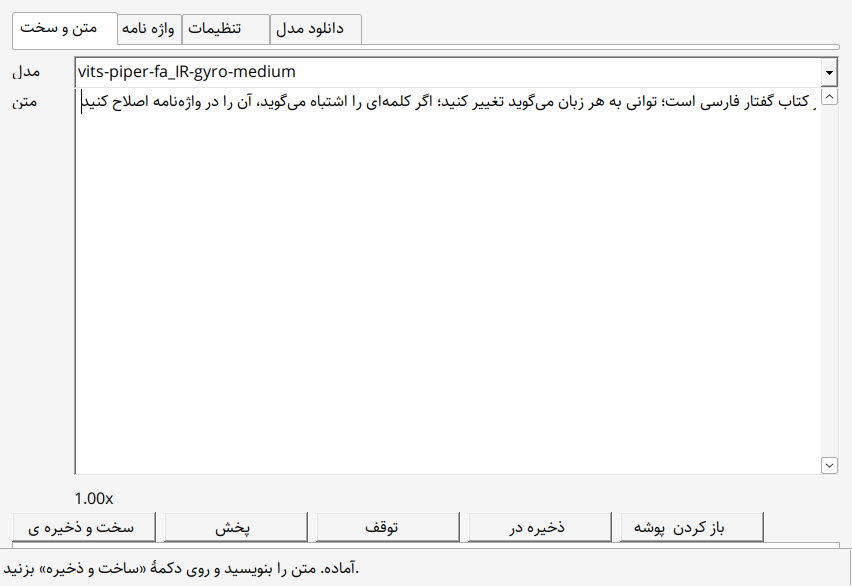
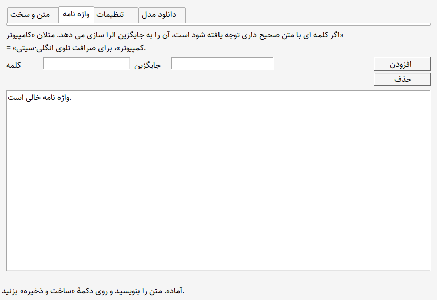
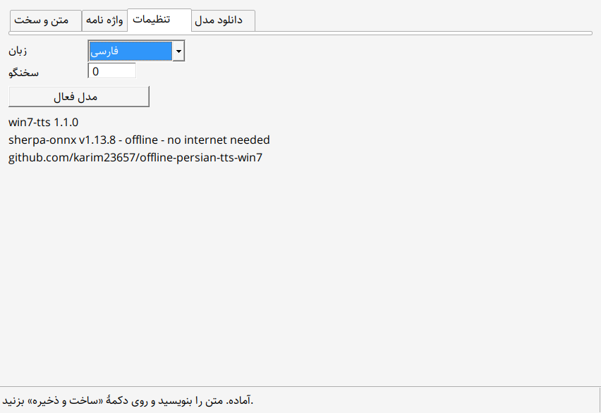
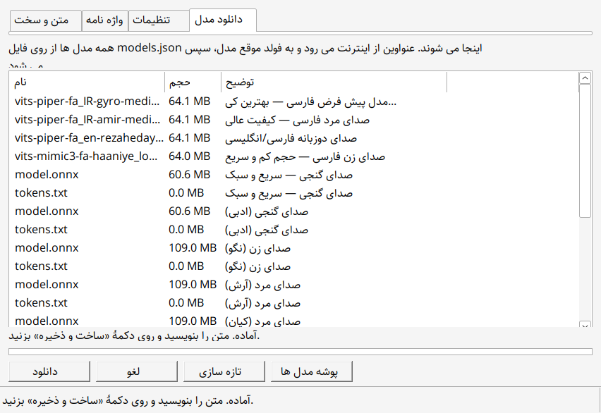
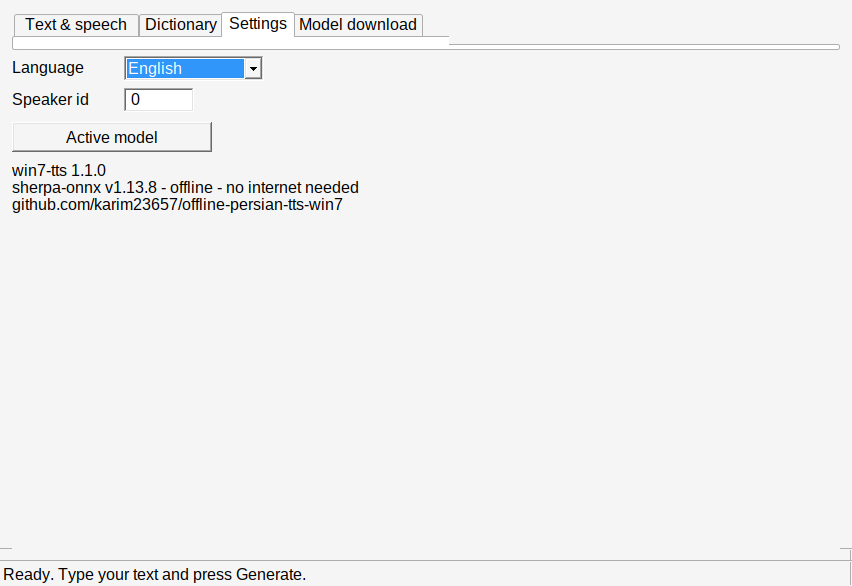
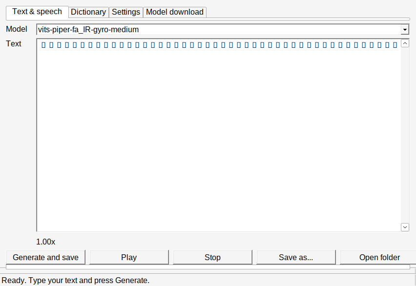

# 🗣️ Win7-TTS — Free Offline Persian Text-to-Speech for Windows 7

**Convert Persian text to natural speech instantly. No internet. No setup. Just download and use.**

> A lightweight, self-contained text-to-speech tool for Windows 7 that works completely offline. Built for Persian, works with any language supported by Piper/VITS models.

---

## 📢 Choose Your Language | انتخاب زبان

- **[English](#-get-started-in-30-seconds)** ← You are here
- **[فارسی (Farsi)](#-شروع-سریع-در-۳۰-ثانیه)**

---

## 💬 Join Us

**[📱 Telegram Channel](https://t.me/persian_tts)** — Get updates, ask questions, share your creations

---

## 🆕 What's New in v1.1.0 (2026-10-13)

- **🗣️ Tabbed GUI** — متن و ساخت / **واژه‌نامه** / تنظیمات / **دانلود مدل**, with a **فارسی / English** switch (RTL + the bundled **Sahel** font in Persian mode).
- **📖 Pronunciation dictionary** (`user.dict`) — tell it how a word *should* be said (`کامپیوتر` → `کمپیوتر`). One file, shared by the GUI, the web UI (`/api/dict`) and `say.exe`.
- **⬇️ Model download in the GUI** — reads the package `models.json` (sizes, links, installed badges), downloads with progress + cancel, extracts with `tar.exe` when available.
- **🧹 Model offload** — switching models (GUI or web) frees the previous one immediately (`/api/unload`); closing the web tab sends a beacon so nothing lingers in memory.
- **⚡ Keep-alive web server** — one HTTP/1.1 connection per browser session (200 requests / 15 s idle), each connection on its own thread, pipelining handled. First request ~1.7 s, repeats ~0.3 s.
- **🔧 New API routes** — `/api/help`, `/api/catalog` (models.json), `/api/dict` (list/add/delete), `/api/unload` (free resident models).
- **⌨️ Better `say.exe`** — `--help`, `--version`, `--list-models`, `--play`, `--no-dict`, auto-detects the model and defaults to `out.wav`.
- **🐛 Bug fixes** — uninitialised `tokens.txt` path in the engine config; a Winsock `SO_RCVTIMEO` set with a POSIX `struct timeval` (the "20-second" receive timeout was really 20 **milliseconds**); a model-slot race in the engine cache that could load a model twice; `say.exe` losing the espeak-ng data directory when run from another folder.

> **Note on phonemes:** the sherpa-onnx C API exposes no phoneme input for these Piper models, so a phoneme-level editor is not possible. The **dictionary** is the real, supported way to fix pronunciations — it substitutes whole words *before* synthesis and works across the GUI, the web UI and the CLI.

---

# 🌐 ENGLISH VERSION

## ⚡ Get Started in 30 Seconds

### 1. Download
👉 **[Download the latest release (ZIP)](https://github.com/karim23657/offline-persian-tts-win7/releases/latest)**

### 2. Extract
Unzip anywhere on your computer.

### 3. Run
Choose your preferred method:

**Option A: Web Interface (Easiest)** 🌐
```bat
scripts\server.cmd
```
Then open your browser to: **http://127.0.0.1:8756/**
- Beautiful web interface
- Works on any device on your network
- No installation needed

**Option B: GUI Application** 🖥️
```bat
scripts\gui.cmd
```
- Graphical interface (native Windows)
- Fastest performance

**Option C: Command Line** ⚡
```bat
scripts\say.cmd "سلام دنیا"
```
- Fastest, no GUI overhead

**That's it.** No Python. No installation. No internet needed. Speech appears in `out.wav`.

---

## 🆕 What's New in 1.1.0

- **Tabbed GUI** with four tabs: text & speech, **pronunciation dictionary**, settings, and **model download** (reads `models.json`, shows sizes, downloads with progress + cancel).
- **Language switch (فارسی / English)** in the GUI: Persian uses RTL and the **Sahel font** (no install needed), English uses LTR.
- **Pronunciation dictionary** (`user.dict`): teach it how a word should be said (`کامپیوتر = کمپیوتر`). One file, shared by the GUI, the web UI (`/api/dict`) and `say.exe`.
- **Model offload**: switching models frees the previous one from memory instantly; closing the web page sends an unload beacon so nothing lingers.
- **Faster web UI**: the server now uses HTTP/1.1 keep-alive (one connection per browser session) and serves each connection on its own thread.
- New API routes: `/api/help`, `/api/catalog`, `/api/dict`, `/api/unload` — full reference at `/api/help` and in the web UI.

---

## 📸 Screenshots

### 🌐 Web interface

| Persian (default, RTL + Sahel font) | English (LTR) |
|:---:|:---:|
|  |  |

### 🖥️ Desktop GUI

| Tab 1 — Text & speech | Tab 2 — Dictionary |
|:---:|:---:|
|  |  |

| Tab 3 — Settings | Tab 4 — Model download |
|:---:|:---:|
|  |  |

| GUI in English (Settings) | GUI in English (Text & speech) |
|:---:|:---:|
|  |  |

---

## 🎯 What Can You Do?

| Task | Command |
|------|---------|
| **Start Web Server** | `scripts\server.cmd` → Open http://127.0.0.1:8756/ |
| **GUI Interface** | `scripts\gui.cmd` |
| **Speak text** | `scripts\say.cmd "سلام دنیا"` |
| **Save as custom file** | `scripts\say.cmd "text" output.wav` |
| **Convert Persian text file** | `scripts\say.cmd --file input.txt` |
| **Batch process (one wav per line)** | `scripts\say_batch.cmd lines.txt` |
| **Download other voices** | `scripts\get_model.cmd` |
| **Troubleshoot problems** | `scripts\diagnose.cmd` |

---

## ✨ Why This Tool?

✅ **Works on Windows 7** — the only offline TTS for old Windows  
✅ **Completely offline** — no internet, no API calls, no tracking  
��� **Persian-first** — supports Persian beautifully (UTF-8)  
✅ **Web Interface** — access from any browser (http://127.0.0.1:8756)  
✅ **Multilingual** — 10+ Persian voices + models for other languages  
✅ **Lightweight** — fits in a USB stick  
✅ **Free and open source** — no ads, no subscriptions  

---

## 🌐 Web Server Mode (NEW!)

The easiest way to use Win7-TTS:

```bat
scripts\server.cmd
```

1. Run the command above
2. Your browser opens automatically to: **http://127.0.0.1:8756/**
3. Type or paste Persian text
4. Click **Generate**
5. Hear the speech and download the `.wav`

**Features:**
- 📱 Works on phone, tablet, or any computer with a browser
- 🔗 Share the URL with others on your network
- 🎨 Beautiful, responsive interface
- 🚀 No plugins, no installation
- 🔐 Completely local — nothing leaves your machine

**Access from:**
- Same computer: `http://localhost:8756` or `http://127.0.0.1:8756`
- Another computer on the network: `http://<your-ip>:8756` (find your IP with `ipconfig`)

---

## 🎤 Available Voices & Models

### Quick Download Links

| Voice | Language | Download | Size¹ | Quality |
|-------|----------|----------|------|---------|
| **`gyro`** ⭐ | Persian (female) | [Included] | 64 MB | Best |
| `amir` | Persian (male) | [Run `get_model.cmd`] | 64 MB | Excellent |
| `reza` | Persian + English | [Run `get_model.cmd`] | 64 MB | Very Good |
| `haaniye` | Persian (female, fast) | [Run `get_model.cmd`] | 64 MB | Good |
| `ganji` | Persian (fast, light) | [Run `get_model.cmd`] | 61 MB | Good |
| `ganji-adabi` | Persian (literary) | [Run `get_model.cmd`] | 61 MB | Very Good |
| `mms` | 1000+ languages | [Run `get_model.cmd`] | 109 MB | Good |
| `negoo` | Persian (Female) | [Run `get_model.cmd`] | 109 MB | Good |
| `arash` | Persian (Male) | [Run `get_model.cmd`] | 109 MB | Good |
| `keyan` | Persian (Male) | [Run `get_model.cmd`] | 109 MB | Good |
| `matab` | Persian (Female) | [Run `get_model.cmd`] | 109 MB | Good |
| `shiva` | Persian (Female) | [Run `get_model.cmd`] | 109 MB | Good |
| `bahman` | Persian (Male) | [Run `get_model.cmd`] | 109 MB | Good |
| `espeak-ng-data` | — (required by all) | [auto-fetched] | 7 MB | — |

> ¹ **Download size.** The four Piper `.tar.bz2` models (gyro, amir, reza,
> haaniye) arrive compressed and extract to roughly the same size on disk; the
> HuggingFace models (ganji … bahman, mms) are shipped as raw `.onnx` files, so
> the number is both the download and the installed size. `espeak-ng-data` is
> fetched automatically the first time you download any non-`mms` model — every
> model needs it for phonemisation, so it is counted once for the whole set.
> The authoritative, machine-readable list is [`models.json`](models.json) at
> the package root (the GUI and the web UI both read it).

**How to download models:**
```bat
# Interactive menu (recommended)
scripts\get_model.cmd

# View all available models
scripts\get_model.cmd list

# Or download from the web interface
- Open http://127.0.0.1:8756/
- Use model selector to download
```

**Manual Download:**
All models are hosted on [HuggingFace](https://huggingface.co/karim23657). Browse and download directly if you prefer.

---

## 📦 Downloads & Releases

Each GitHub release ships three version-stamped archives under `dist/`, so you
take only what you need — **with or without the models**:

| Archive | Contains | Size | Get this if... |
|---------|----------|------|----------------|
| `win7-tts-<ver>-runtime.zip` | Program only (`runtime\`, `scripts\`, docs). **No models.** | ~9 MB | You want a fast download and will fetch a voice once with `scripts\get_model.cmd`. |
| `win7-tts-<ver>-models.zip` | Just the voices + `espeak-ng-data`. | ~64 MB per voice | You already have the program and want to add or refresh voices. |
| `win7-tts-<ver>-full.zip` | Program **and** models together. | ~73 MB | You want it to work offline straight away, with zero setup. |

> The legacy name `win7-tts-runtime-only.zip` is identical to the `-runtime`
> archive and is still published for older links and bug reports.

Every release also ships `SHA256SUMS.txt`. Verify a download on Windows with:

```bat
certutil -hashfile win7-tts-1.1.0-full.zip SHA256
```

then compare the output against the matching line in `SHA256SUMS.txt`.

**Which one should I pick?** For most people the **`-full`** archive: extract it
and double-click `scripts\gui.cmd`. Only grab the `-runtime` archive if
bandwidth matters (it is ~8× smaller) and you are happy to download a voice the
first time you run it.

To rebuild these archives yourself from a checkout (the model-bearing ones need
`models\` populated):

```bat
make release
```

This writes all three archives plus `SHA256SUMS.txt` into `dist\`.

---

## 📖 First Time? Read This

### Web Interface Method (Recommended for Beginners) 🌐

1. Extract the ZIP
2. Double-click `scripts\server.cmd`
3. Browser opens automatically
4. Type or paste Persian text
5. Click **Generate**
6. Hear the speech play back in the browser
7. Click **Download** to save the `.wav` file

### GUI Method (Windows Application) 🖥️

1. Extract the ZIP
2. Double-click `scripts\gui.cmd`
3. Type or paste Persian text (try **Ctrl+A** to select all)
4. Click **Generate and save** — speech plays automatically, `out.wav` is written next to the exe
5. Use **Save as…** to pick another file, or **Open folder** to reveal it

The window has four tabs:

| Tab | What it does |
|-----|--------------|
| **متن و ساخت / Text & speech** | Model picker, text box, generate / play / stop, save-as |
| **واژه‌نامه / Dictionary** | Teach it how a word should be said (e.g. `کامپیوتر` → `کمپیوتر`). Saved to `user.dict`, shared with the web UI and `say.exe` |
| **تنظیمات / Settings** | فارسی / English switch (RTL + Sahel font), speaker id, version info |
| **دانلود مدل / Model download** | Browse `models.json`, download with progress + cancel |

Switching the model evicts the previous one from memory instantly — only one model stays resident.

### Command Line Method ⚡

```bat
# Simple: just speak
scripts\say.cmd "سلام"

# Save to a file
scripts\say.cmd "سلام دنیا" output.wav

# From a UTF-8 text file (BEST for Persian)
scripts\say.cmd --file input.txt output.wav

# Change speed
scripts\say.cmd --file input.txt output.wav --speed 1.5

# One wav file per line of text
scripts\say_batch.cmd lines.txt

# What's installed / help / version
scripts\say.cmd --list-models
scripts\say.cmd --help
scripts\say.cmd --version

# Play the result straight away, skipping the dictionary
scripts\say.cmd "سلام" --play --no-dict
```

**Always use `--file` for Persian** — it handles special characters correctly.

### Web API

Start the server (`scripts\server.cmd`), then browse to **http://127.0.0.1:8756/api/help** for the full route list. Highlights:

| Route | Purpose |
|-------|---------|
| `POST /api/synthesize` | text → WAV (model, speed, speaker_id, ...) |
| `GET  /api/models` | installed models |
| `GET  /api/catalog` | the downloadable catalog (`models.json`) |
| `GET/POST /api/dict` | list / add / delete dictionary entries (`{"delete":1}`) |
| `POST /api/unload` | free resident models (`{}` = all, `{"keep":"name"}` = all but one) |
| `GET  /api/health`, `/api/help` | status and route reference |

The quick table above is a pointer — the **complete references for the GUI, the
CLI and the HTTP API** are in their own sections further down. Jump to:

- [🖥️ Complete GUI Guide](#-complete-gui-guide)
- [⚡ Complete CLI Reference](#-complete-cli-reference)
- [🔌 Complete HTTP API Reference](#-complete-http-api-reference)

---

## 🖥️ Complete GUI Guide

Launch it with `scripts\gui.cmd` (or double-click `runtime\tts_gui.exe`). It is
a single native window — no install, no runtime dependencies beyond the bundled
`runtime\` folder. The first model warms in the background while the window is
already usable.

### Window layout

```
┌──────────────────────────────────────────────────────────┐
│ [Text & speech] [Dictionary] [Settings] [Model download] │  ← tabs (Ctrl+Tab)
│                                                          │
│  Model:  [ ▾ vits-piper-fa_IR-gyro-medium        ]      │
│  Text:   ┌────────────────────────────────────────────┐  │
│          │  (RTL Persian / LTR English text box,      │  │
│          │   Ctrl+A selects all)                      │  │
│          └────────────────────────────────────────────┘  │
│  Speed: 1.00x                                            │
│  [Generate and save] [Play] [Stop] [Save as…] [Open…]   │  ← equal-width
│  ▓▓▓▓▓▓▓▓▓▓░░░░░░░░░░░░░░░░░░░░░░░░░░░░░ progress       │
├──────────────────────────────────────────────────────────┤
│ آماده. متن را بنویسید…                          status bar│
└──────────────────────────────────────────────────────────┘
```

### Tab 1 — Text & speech (متن و ساخت)

| Control | What it does |
|---------|--------------|
| **Model** dropdown | Every valid folder under `models\`. Picking a different one **evicts the previous model from RAM immediately** — only one model is ever resident. |
| **Text** box | Any script. Persian is right-to-left; English is left-to-right. **Ctrl+A** selects all. |
| **Speed** | Speech rate shown live (default `1.00x`); `--speed` on the CLI is the same knob. |
| **Generate and save** | Synthesises, auto-plays, and writes `out.wav` next to the exe. Shows seconds + sample rate when done. |
| **Play** | Re-plays the last generated audio without re-synthesising. |
| **Stop** | Best-effort cancel: sets a flag the audio callback checks, then discards the result. Reports "Cancelled." honestly. |
| **Save as…** | Save the last result to any path you pick. |
| **Open folder** | Reveal the output in Explorer. |

### Tab 2 — Dictionary (واژه‌نامه)

The dictionary is **real word substitution applied before synthesis** — not a
phoneme editor (the sherpa-onnx C API exposes no phoneme input for these
models, so a phoneme-level editor is not possible; substitution is the honest,
supported way to fix a pronunciation).

| Control | What it does |
|---------|--------------|
| **Word** | The word as it is written in your text (e.g. `کامپیوتر`). |
| **Said as** | How it should actually be said (e.g. `کمپیوتر`). |
| **Add / update** | Add or overwrite the entry. Matching is whole-word, case-insensitive for ASCII, and multi-pass. |
| **Delete** | Remove the selected entry. |
| **List** | Every entry in `user.dict`, or "The dictionary is empty." |

The entries live in **`user.dict` at the package root**, and are shared
verbatim by the GUI, the web UI (`/api/dict`) and `say.exe`. Add an entry in
one place and it applies to the very next synthesis everywhere — the file is a
few hundred bytes, so it is re-read on every request on purpose.

### Tab 3 — Settings (تنظیمات)

| Control | What it does |
|---------|--------------|
| **Language** | فارسی / English. Persian flips the whole UI to right-to-left and switches to the **Sahel font** (loaded from `sahel.ttf`, no install needed); English uses LTR + Segoe UI. |
| **Speaker id** | For multi-speaker models (`--sid` on the CLI is the same). |
| **Active model** | Jump straight back to Tab 1 with that model selected. |
| **About** | Version and build info. |

### Tab 4 — Model download (دانلود مدل)

Reads the package-root **[`models.json`](models.json)** catalog and lists every
available model with its real size and description.

| Control | What it does |
|---------|--------------|
| **List** | Name / size / description, straight from `models.json`. |
| **Download** | Fetches via WinInet with a live progress bar. `.tar.bz2` archives are extracted with `tar` when available; plain `.onnx` models are copied into `models\` directly. |
| **Cancel** | Abort a download in flight (partial file is discarded). |
| **Refresh** | Re-read `models.json` (picks up an edited catalog without a restart). |
| **Models folder** | Open `models\` in Explorer. |

Downloads are written to a **`.part` temp file and renamed into place**, so an
interrupted download can never be mistaken for a finished model.

### Keyboard shortcuts

| Shortcut | Action |
|----------|--------|
| **Ctrl+Tab** / **Ctrl+Shift+Tab** | Next / previous tab (wraps around). |
| **Ctrl+A** | Select all in the focused edit box or list. |

### Memory behaviour

Switching models in the dropdown frees the previous one instantly, and closing
the window releases everything. Two large models never sit in memory together
by accident.

---

## ⚡ Complete CLI Reference

Two executables live in `runtime\`:

- **`say.exe`** — synthesise text to a `.wav`
- **`tts_server.exe`** — the local web server (see the API section)

### say.exe

```bat
say.exe [options] (--text <text> | --text-file <file>)
```

| Flag | Default | Meaning |
|------|---------|---------|
| `--model <dir>` | auto-detect | Model folder. Auto-detect prefers `vits-piper-fa_IR-gyro-medium`, then any valid folder under `models\`. |
| `--out <file.wav>` | `out.wav` | Output path (relative to the current directory). |
| `--text <text>` | — | Text to speak. **For Persian, prefer `--text-file`** — a Windows console code page can mangle raw Unicode on the command line. |
| `--text-file <f>` | — | Read **UTF-8** text from a file (BOM tolerated). The correct path for Persian. |
| `--split` | off | With `--text-file`: one `.wav` per non-empty line, named `<n>_<out>.wav`. The model loads once, so a long list runs at full speed. |
| `--speed <f>` | `1.0` | Speech rate. |
| `--sid <int>` | `0` | Speaker id for multi-speaker models. |
| `--threads <int>` | `2` | Backend threads. |
| `--scale <f>` | `1.0` | VITS length scale; `>1` is slower/more deliberate. |
| `--play` | off | Play the result through the sound device after writing it. |
| `--no-dict` | off | Skip `user.dict` substitution for this run. |
| `--list-models` | — | List installed models and exit. |
| `-h`, `--help` | — | Full usage and exit. |
| `--version` | — | Print `win7-tts say 1.1.0` and exit. |

**Examples**

```bat
:: simplest: auto-detects the model, writes out.wav
say.exe --text "Hello world"

:: CI / scripting syntax: fully explicit
say.exe --model models\vits-piper-fa_IR-gyro-medium --out out.wav --text "Hello"

:: Persian from a UTF-8 file (the correct path for Persian)
say.exe --model models\vits-piper-fa_IR-gyro-medium --out speech.wav --text-file poem.txt

:: one wav per line, played as it goes, ignoring the dictionary
say.exe --text-file lines.txt --split --out clips\ --play --no-dict

:: just inspect the install
say.exe --list-models
```

The model loads **once per invocation** and is reused for every sentence, so
`--split` on a long file is dramatically faster than calling `say.exe` per line.

### tts_server.exe

```bat
tts_server.exe [options]
```

| Flag | Default | Meaning |
|------|---------|---------|
| `--port <n>` | `8756` | Port to listen on. |
| `--host <a>` | `127.0.0.1` | Address to bind. |
| `--models <d>` | `<exe>\..\models` | Models folder. |
| `--preload` | off | Load the first model before serving, so the first request is fast. |
| `--quiet` | off | Do not log requests. |
| `-h`, `--help` | — | Usage. |

The `scripts\*.cmd` wrappers are thin conveniences over these:

| Script | Wraps |
|--------|-------|
| `scripts\say.cmd "text" [out.wav]` | `say.exe` with the gyro model preselected; `--file` maps to `--text-file`. |
| `scripts\say_batch.cmd lines.txt [outdir]` | `say.exe --split` into one folder. |
| `scripts\server.cmd [--port N] [--no-preload]` | `tts_server.exe` (defaults to `--preload`). |
| `scripts\gui.cmd` | `tts_gui.exe`. |
| `scripts\get_model.cmd [name]` | Download a model from `models.json`. |
| `scripts\diagnose.cmd` | Environment probe for bug reports. |

---

## 🔌 Complete HTTP API Reference

Start the server (`scripts\server.cmd` or `runtime\tts_server.exe`), then talk
to it on `http://127.0.0.1:8756/`. Everything is plain HTTP — it works from a
browser, `curl`, PowerShell, or any language.

> Live, curl-able copy of this reference: **`GET /api/help`**

### Connection semantics

| Property | Behaviour |
|----------|-----------|
| Protocol | HTTP/1.1 **keep-alive** — reuse one connection for many requests. |
| Limits | 200 requests or 15 s idle, then the server closes. |
| Concurrency | **Thread per connection** — one slow request never blocks another client. |
| Pipelining | Requests sent back-to-back on one socket are all answered (extra bytes are held, not dropped). |
| `Connection: close` | Honoured — the server closes after replying. |
| HTTP/1.0 | Answered, with a "please close" hint. |
| Oversized body | `413`. |
| POST with no `Content-Length` | `411`. |
| Wrong method for a route | `405`. |

### `GET /api/health`

No parameters. Returns JSON status:

```json
{"status":"ok","uptime_s":42,"models_installed":3,
 "models_loaded":1,"requests":17,"port":8756}
```

### `GET /api/models`

No parameters. Every valid folder under `models\`, with a `loaded` flag:

```json
{"models":[{"name":"vits-piper-fa_IR-gyro-medium","loaded":true}]}
```

### `GET /api/catalog`

No parameters. Serves the package-root [`models.json`](models.json) verbatim —
the full download catalog with real sizes and descriptions.

### `GET /api/help`

No parameters. This whole reference, as plain text.

### `POST /api/warmup`

```json
{"model":"vits-piper-fa_IR-gyro-medium"}
```

Loads the model now (instead of on first synthesis) and reports how long it
took — useful for benchmarking or pre-warming before a batch.

### `POST /api/unload`

Free resident models — the offload half of the model-switch policy:

| Body | Effect |
|------|--------|
| `{}` | Free **every** resident model. |
| `{"keep":"name"}` | Free everything **except** that model. The web UI sends this when you change the model dropdown. |
| `{"model":"name"}` | Free just that model. |

The web UI also sends an unload beacon on `pagehide`, so closing the tab frees
the model without you doing anything.

### `GET /api/dict` · `POST /api/dict`

Read and edit the pronunciation dictionary (`user.dict`, shared with the GUI
and `say.exe`). Matching is whole-word, case-insensitive for ASCII, and
multi-pass.

```bat
:: list
curl http://127.0.0.1:8756/api/dict

:: add / update
curl -X POST http://127.0.0.1:8756/api/dict -d "{\"word\":\"کامپیوتر\",\"repl\":\"کمپیوتر\"}"

:: delete
curl -X POST http://127.0.0.1:8756/api/dict -d "{\"word\":\"کامپیوتر\",\"delete\":true}"
```

### `POST /api/synthesize`

JSON body in, `audio/wav` out:

| Field | Type | Default | Meaning |
|-------|------|---------|---------|
| `text` | string | **required** | What to say. `400` if empty. |
| `model` | string | first/auto | Model folder name under `models\`. `404` if not installed. |
| `speed` | number | `1.0` | Rate. Clamped to `0.3–3.0`. |
| `sid` | int | `0` | Speaker id for multi-speaker models. |

```bat
curl -X POST http://127.0.0.1:8756/api/synthesize ^
     -d "{\"text\":\"سلام دنیا\",\"model\":\"vits-piper-fa_IR-gyro-medium\",\"speed\":1.1}" ^
     --output out.wav
```

### `GET /api/synthesize`

The same synthesis via query string, so it can be dropped straight into an
`<audio src="...">`:

```
GET /api/synthesize?text=...&model=...&speed=1.0&sid=0
```

Parameters are URL-encoded and capped by the URL length — for long text use
`POST`.

### Pronunciation dictionary

Synthesis honours `user.dict` on every request (it is re-read per request on
purpose, so an entry added in the GUI applies to the very next web request).
Pass `--no-dict` to `say.exe` to bypass it for one run.

### Error responses

Errors are JSON with a human-readable `error`:

| Code | When |
|------|------|
| `400` | No `text` supplied. |
| `404` | Unknown route, or the requested model is not installed. |
| `405` | Wrong HTTP method for the route. |
| `411` | POST without `Content-Length`. |
| `413` | Request body too large. |
| `500` | Synthesis failed (message carries the engine's reason). |

---

## ❓ Frequently Asked Questions

### Q: What's the easiest way to use this?
**A:** Use the web server:
```bat
scripts\server.cmd
```
Then open http://127.0.0.1:8756 in your browser. No installation needed!

### Q: Can I access the web interface from my phone?
**A:** Yes! Find your computer's IP (run `ipconfig` in Command Prompt), then visit `http://<your-ip>:8756` from your phone. Both must be on the same network.

### Q: Why is it just question marks "????"?
**A:** You're using the wrong method. Always use:
```bat
scripts\say.cmd --file yourfile.txt
```
Make sure your text file is saved as **UTF-8** (Notepad: Save As → Encoding: UTF-8).

### Q: I see "Failed to create DXGI factory"
**A:** That's normal. The engine looks for a graphics card. You don't have one (or don't need one), and that's fine. Keep going.

### Q: The audio is just silence or very quiet
**A:** Your CPU might be old. Run this to check:
```bat
scripts\diagnose.cmd
```
If it says `AVX: NO`, your CPU is too old (pre-2011).

### Q: Can I use this on Windows 10/11?
**A:** Yes, it works on modern Windows too. But it's optimized for Windows 7.

### Q: How do I change the voice speed?
**A:**
```bat
scripts\say.cmd --file text.txt output.wav --speed 1.5
```
- `1.0` = normal
- `1.5` = 50% faster
- `0.8` = 20% slower

### Q: How do I download additional models/voices?
**A:** Run this command:
```bat
scripts\get_model.cmd
```
Then choose the voice you want from the menu. It will download automatically to the `models\` folder.

Or use the web interface:
- Go to http://127.0.0.1:8756/
- Click the model selector
- Choose and download

---

## 🔧 Troubleshooting

### "The procedure entry point could not be located"
→ The `runtime\` folder is incomplete. **Re-extract the ZIP from the release.**

### "VCRUNTIME140.dll was not found"
→ Install the [Visual C++ 2015-2022 Redistributable (x64)](https://support.microsoft.com/en-us/help/2977003)

### "could not create the TTS engine"
→ The model folder is missing or has the wrong path. Run:
```bat
scripts\diagnose.cmd
```

### Server won't start / "Port 8756 already in use"
→ Another application is using port 8756. Either:
1. Close the other application
2. Edit `scripts\server.cmd` and change `8756` to a different port (e.g., `8757`)
3. Stop the server with `Ctrl+C` in the Command Prompt

### Speech is very slow / CPU is maxed
→ VITS models are CPU-intensive. Try:
```bat
scripts\say.cmd --file text.txt output.wav --threads 2
```
Or switch to the smaller `ganji` model (16 kHz).

### Still stuck?
→ Run the diagnostic:
```bat
scripts\diagnose.cmd
```
Copy the **entire output** and open an issue on GitHub or ask in our [Telegram channel](https://t.me/persian_tts).

---

## 📁 What's Inside?

```
win7-tts\
  ├─ README.md                     ← you are here
  ├─ scripts\
  │  ├─ server.cmd                 ← start web interface (NEW!)
  │  ├─ gui.cmd                    ← visual interface
  │  ├─ say.cmd                    ← command line tool
  │  ├─ say_batch.cmd              ← batch processor
  │  ├─ get_model.cmd              ← download voices
  │  ├─ diagnose.cmd               ← troubleshoot
  │  └─ gui.py                     ← Python GUI (optional)
  ├─ runtime\                      ← the engine (don't move files around)
  │  ├─ sherpa-onnx-offline-tts.exe
  │  ├─ say.exe
  │  ├─ tts_gui.exe
  │  ├─ tts_server.exe             ← web server executable
  │  ├─ w7shim.dll                 ← Windows 7 compatibility
  │  └─ *.dll                      ← libraries
  ├─ models\
  │  └─ vits-piper-fa_IR-gyro-medium\  ← default voice (already included)
  ├─ docs\                         ← technical documentation
  └─ out.wav                       ← where your audio files are saved
```

---

## 🚀 Advanced Options

### Use Different Voice
Edit the `MODEL_DIR` line in `scripts\say.cmd`:
```bat
set "MODEL_DIR=%CD%\models\vits-piper-fa_IR-amir-medium"
```

### Run Server on Custom Port
Edit `scripts\server.cmd`:
```bat
runtime\tts_server.exe --port 9000
```

### Drive the Engine Directly
For experts only:
```bat
runtime\sherpa-onnx-offline-tts.exe ^
  --vits-model=models\gyro\fa_IR-gyro-medium.onnx ^
  --vits-tokens=models\gyro\tokens.txt ^
  --vits-data-dir=models\gyro\espeak-ng-data ^
  --output-filename=out.wav "hello"
```

### Batch Processing
Generate one `.wav` per line of a text file:
```bat
scripts\say_batch.cmd myfile.txt
```
Output goes to `lines\` folder (one file per line).

---

## 🛠️ For Developers

Want to understand how it works or contribute?

- **[How it works](docs/how_to.md)** — architecture and design decisions
- **[Compiling](docs/compiling.md)** — build from source
- **[Windows 7 fixes](docs/win7.md)** — the technical challenges and solutions
- **[Upgrading sherpa-onnx](docs/upgrading-sherpa.md)** — update the engine
- **[Publishing](docs/github-upload.md)** — release process

---

## 🎓 Key Features Explained

### ✅ Works Offline
No internet connection needed. The model and engine are bundled. This is a **huge** advantage over web APIs like Google TTS or Azure Speech.

### ✅ No Installation
Just extract and run. No Python. No admin rights. No registry changes. Perfect for USB sticks or locked-down machines.

### ✅ Web Interface
Access from any browser — desktop, phone, tablet. Share across your network. No plugins or extensions needed.

### ✅ Handles Persian Correctly
Persian text needs **UTF-8 encoding**. Most tools fail here. We handle it automatically — Persian text will sound correct.

### ✅ Multiple Voices & Languages
Start with Persian (`gyro` voice). Download more via `scripts\get_model.cmd`. We have 10+ Persian voices and multilingual models.

### ✅ Small Download
Only 200-500 MB depending on which models you add. Small enough for USB.

---

## ❗ Common Issues at a Glance

| Problem | Solution |
|---------|----------|
| "????" instead of Persian | Use `--file` with UTF-8 text file |
| No audio / silence | CPU too old? Run `scripts\diagnose.cmd` |
| DLL not found errors | Reinstall Visual C++ 2015-2022 Redistributable (x64) |
| "procedure entry point" error | Re-extract the ZIP file |
| Server won't start | Port 8756 in use. Change port in `server.cmd` |
| Very slow synthesis | Lower `--threads`, or use smaller model |

---

## 📊 Performance

| Model | Speed | Quality | Size |
|-------|-------|---------|------|
| gyro (default) | Fast | Best | 64 MB |
| ganji | Fastest | Good | 61 MB |
| haaniye | Fast | Good | 64 MB |
| mms | Medium | Good | 109 MB |

On a modern CPU (2011+), expect **real-time or faster** (speech takes 3 seconds, synthesis takes 2-3 seconds).

---

## 📜 License & Credits

- **sherpa-onnx** (k2-fsa) — Apache-2.0
- **ONNX Runtime** (Microsoft) — MIT
- **Piper / VITS models** — individual licenses (see each model)
- **This tool** — MIT

Persian models by [karim23657](https://huggingface.co/karim23657)

---

## 🤝 Need Help?

1. **Read the FAQ above** — most questions are answered
2. **Run the diagnostic** — `scripts\diagnose.cmd` and paste the output
3. **Join our Telegram** — **[📱 Telegram Channel](https://t.me/persian_tts)** 
4. **Check the docs** — see `docs/` folder for technical details
5. **Open an issue** — [GitHub Issues](https://github.com/karim23657/offline-persian-tts-win7/issues)

---

## 🌍 Use Cases

✅ Create audiobooks in Persian  
✅ Generate voiceovers for videos  
✅ Automate speech for accessibility tools  
✅ Build chatbots with speech output  
✅ Test pronunciation  
✅ Learn Persian pronunciation  
✅ Use on old machines that can't run modern software  
✅ Web-based interface for shared use across a network  

---

## What Makes This Different?

| Feature | This Tool | Google TTS | Azure Speech | Piper |
|---------|-----------|-----------|--------------|-------|
| **Offline** | ✅ | ❌ | ❌ | ✅ |
| **Windows 7** | ✅ | ❌ | ❌ | ❌ |
| **Persian** | ✅ | ✅ | ✅ | ❌ |
| **Free** | ✅ | ❌ | ❌ | ✅ |
| **GUI** | ✅ | N/A | N/A | ❌ |
| **Web Interface** | ✅ | N/A | N/A | ❌ |
| **No setup** | ✅ | N/A | ❌ | ❌ |

---

**🎉 Ready? [Download the latest release now](https://github.com/karim23657/offline-persian-tts-win7/releases/latest)**

Extract → Run `scripts\server.cmd` → Open browser → Type Persian → Hear speech. Done!

---

---

---

# 🌐 نسخه فارسی

# 🗣️ Win7-TTS — متن به گفتار فارسی آفلاین برای ویندوز 7

**متن فارسی را به گفتار طبیعی تبدیل کنید. بدون اینترنت. بدون نصب. فقط دانلود و استفاده کنید.**

---

## 💬 به ما بپیوندید

**[📱 کانال تلگرام](https://t.me/persian_tts)** — به‌روزرسانی‌ها، پاسخ سؤالات، اشتراک‌گذاری آفرینش‌ها

---

## 🆕 چه چیزی در نسخه ۱.۱.۰ جدید است؟

- **🗣️ برنامه GUI با زبانه‌ها** — متن و ساخت / **واژه‌نامه** / تنظیمات / **دانلود مدل**، همراه با سوییچ **فارسی / English** (راست‌به‌چپ + فونت **ساحل** در حالت فارسی).
- **📖 واژه‌نامه تلفظ** (`user.dict`) — به برنامه بگویید کلمه چطور باید خوانده شود (`کامپیوتر` → `کمپیوتر`). یک فایل مشترک بین GUI، رابط وب (`/api/dict`) و `say.exe`.
- **⬇️ دانلود مدل در GUI** — فایل `models.json` را می‌خواند (حجم، پیوند، نشان نصب)، با نمایش پیشرفت و امکان لغو دانلود می‌کند و با `tar.exe` استخراج می‌کند.
- **🧹 آزادسازی مدل** — با عوض کردن مدل (در GUI یا وب) مدل قبلی فوراً از حافظه آزاد می‌شود (`/api/unload`); با بستن صفحه وب، یک پیام خودکار ارسال می‌شود.
- **⚡ سرور وب سریع‌تر** — اتصال HTTP/1.1 پایدار برای هر نشست مرورگر (۲۰۰ درخواست / ۱۵ ثانیه بی‌کاری)، هر اتصال در نخ جداگانه. اولین درخواست ~۱.۷ ثانیه، بعدی‌ها ~۰.۳ ثانیه.
- **🔧 مسیرهای API جدید** — `/api/help`، `/api/catalog` (models.json)، `/api/dict` (فهرست/افزودن/حذف)، `/api/unload` (آزادسازی مدل‌ها).
- **⌨️ `say.exe` بهتر** — `--help`، `--version`، `--list-models`، `--play`، `--no-dict`، تشخیص خودکار مدل و خروجی پیش‌فرض `out.wav`.
- **🐛 رفع اشکال** — مسیر `tokens.txt` مقداردهی‌نشده در پیکربندی موتور؛ `SO_RCVTIMEO` ویندوز با `struct timeval` پوزیکسی تنظیم می‌شد (مهلت «۲۰ ثانیه‌ای» در واقع ۲۰ **میلی‌ثانیه** بود!)؛ یک مسابقه اسلات مدل در کش موتور که می‌توانست مدل را دو بار بارگذاری کند؛ `say.exe` وقتی از پوشه دیگری اجرا می‌شد پوشه espeak-ng-data را گم می‌کرد.

> **درباره آوانگاشت (فونم):** API سی sherpa-onnx برای این مدل‌های Piper ورودی فونم ندارد، بنابراین ویرایشگر سطح فونم ممکن نیست. **واژه‌نامه** راه عملی و واقعی برای اصلاح تلفظ است — پیش از ساخت صدا، جایگزینی کلمه‌ای انجام می‌دهد و در GUI، رابط وب و خط فرمان یکسان کار می‌کند.

---

## 📸 تصاویر

### 🌐 رابط وب

| فارسی (پیش‌فرض، راست‌به‌چپ + فونت ساحل) | English (چپ‌به‌راست) |
|:---:|:---:|
|  |  |

### 🖥️ برنامهٔ دسکتاپ (GUI)

| زبانه ۱ — متن و ساخت | زبانه ۲ — واژه‌نامه |
|:---:|:---:|
|  |  |

| زبانه ۳ — تنظیمات | زبانه ۴ — دانلود مدل |
|:---:|:---:|
|  |  |

| GUI در حالت English (تنظیمات) | GUI در حالت English (متن و ساخت) |
|:---:|:---:|
|  |  |

---

## ⚡ شروع سریع در ۳۰ ثانیه

### 1. دانلود
👉 **[دانلود آخرین نسخه (ZIP)](https://github.com/karim23657/offline-persian-tts-win7/releases/latest)**

### 2. استخراج فایل
فای�� ZIP را در هر جای کامپیوتر خود استخراج کنید.

### 3. اجرا
یکی از این روش‌ها را انتخاب کنید:

**گزینه الف: وب‌سایت (ساده‌ترین)** 🌐
```bat
scripts\server.cmd
```
سپس در مرورگر خود باز کنید: **http://127.0.0.1:8756/**
- رابط وب زیبا
- از هر دستگاهی در شبکه کار می‌کند
- نیاز به نصب ندارد

**گزینه ب: برنامه GUI** 🖥️
```bat
scripts\gui.cmd
```
- رابط گرافیکی (ویندوز بومی)
- سریع‌ترین کارایی

**گزینه ج: خط فرمان** ⚡
```bat
scripts\say.cmd "سلام دنیا"
```
- سریع‌ترین، بدون GUI

**همین است.** بدون Python. بدون نصب. بدون اینترنت. فایل صوتی در `out.wav` ذخیره می‌شود.

---

## 🎯 کار‌های ممکن

| کار | دستور |
|-----|--------|
| **شروع سرور وب** | `scripts\server.cmd` → باز کردن http://127.0.0.1:8756/ |
| **رابط GUI** | `scripts\gui.cmd` |
| **گفتن متن** | `scripts\say.cmd "سلام دنیا"` |
| **ذخیره در فایل سفارشی** | `scripts\say.cmd "متن" output.wav` |
| **تبدیل فایل متنی فارسی** | `scripts\say.cmd --file input.txt` |
| **پردازش دسته‌ای** | `scripts\say_batch.cmd lines.txt` |
| **دانلود صدای دیگر** | `scripts\get_model.cmd` |
| **رفع مشکل** | `scripts\diagnose.cmd` |

---

## ✨ چرا این ابزار؟

✅ **برای ویندوز 7** — تنها ابزار متن به گفتار آفلاین برای ویندوز قدیم  
✅ **کاملاً آفلاین** — بدون اینترنت، بدون ردگیری  
✅ **بهینه برای فارسی** — از UTF-8 به‌درستی پشتیبانی می‌کند  
✅ **رابط وب** — از هر مرورگری دسترسی (http://127.0.0.1:8756)  
✅ **چند صدای فارسی** — بیش از ۱۰ صدای مختلف فارسی  
✅ **سبک و کوچک** — در یک فلش مموری جا می‌گیرد  
✅ **رایگان و متن‌باز** — بدون تبلیغات و اشتراک  

---

## 🌐 حالت سرور وب (جدید!)

ساده‌ترین راه برای استفاده از Win7-TTS:

```bat
scripts\server.cmd
```

1. دستور بالا را اجرا کنید
2. مرورگر شما خودکار باز می‌شود: **http://127.0.0.1:8756/**
3. متن فارسی را تایپ یا چسباندن کنید
4. روی **Generate** کلیک کنید
5. صدا پخش می‌شود و می‌توانید دانلود کنید

**ویژگی‌ها:**
- 📱 از گوشی، تبلت یا هر کامپیوتری با مرورگر کار می‌کند
- 🔗 آدرس را با دیگران در شبکه به‌اشتراک بگذارید
- 🎨 رابط زیبا و پاسخ‌گو
- 🚀 بدون پلاگین، بدون نصب
- 🔐 کاملاً محلی — هیچ اطلاعاتی به بیرون نمی‌رود

**دسترسی از:**
- همان کامپیوتر: `http://localhost:8756` یا `http://127.0.0.1:8756`
- کامپیوتر دیگری در شبکه: `http://<your-ip>:8756` (IP خود را با `ipconfig` پیدا کنید)

---

## 🎤 صداها و مدل‌های دانلودی

| صدا | زبان | دانلود | حجم¹ | کیفیت |
|-----|------|--------|------|-------|
| **`gyro`** ⭐ | فارسی (زنانه) | [موجود است] | ۶۴ MB | بهترین |
| `amir` | فارسی (مردانه) | [اجرای `get_model.cmd`] | ۶۴ MB | عالی |
| `reza` | فارسی + انگلیسی | [اجرای `get_model.cmd`] | ۶۴ MB | خوب جداً |
| `haaniye` | فارسی (زنانه، سریع) | [اجرای `get_model.cmd`] | ۶۴ MB | خوب |
| `ganji` | فارسی (سریع و سبک) | [اجرای `get_model.cmd`] | ۶۱ MB | خوب |
| `ganji-adabi` | فارسی (ادبی) | [اجرای `get_model.cmd`] | ۶۱ MB | خوب جداً |
| `mms` | ۱۰۰۰+ زبان | [اجرای `get_model.cmd`] | ۱۰۹ MB | خوب |
| `negoo` | فارسی (زنانه) | [اجرای `get_model.cmd`] | ۱۰۹ MB | خوب |
| `arash` | فارسی (مردانه) | [اجرای `get_model.cmd`] | ۱۰۹ MB | خوب |
| `keyan` | فارسی (مردانه) | [اجرای `get_model.cmd`] | ۱۰۹ MB | خوب |
| `matab` | فارسی (زنانه) | [اجرای `get_model.cmd`] | ۱۰۹ MB | خوب |
| `shiva` | فارسی (زنانه) | [اجرای `get_model.cmd`] | ۱۰۹ MB | خوب |
| `bahman` | فارسی (مردانه) | [اجرای `get_model.cmd`] | ۱۰۹ MB | خوب |
| `espeak-ng-data` | — (برای همه لازم) | [خودکار] | ۷ MB | — |

> ¹ **حجم دانلود.** چهار مدل Piper با پسوند `.tar.bz2` (gyro, amir, reza,
> haaniye) فشرده می‌آیند و پس از استخراج تقریباً همین اندازه روی دیسک می‌شوند؛
> مدل‌های هافینگ‌فیس (ganji تا bahman و mms) به‌صورت فایل خام `.onnx` عرضه
> می‌شوند، پس همین عدد هم حجم دانلود و هم حجم نصب است. `espeak-ng-data` در اولین
> دانلود هر مدلی به‌جز `mms` به‌خودکار دریافت می‌شود — همهٔ مدل‌ها برای
> آواشنسی به آن نیاز دارند و فقط یک‌بار برای کل مجموعه شمرده می‌شود. فهرست
> ماشین‌خوان و مرجع دقیق، [`models.json`](models.json) در ریشهٔ بسته است
> (هر دو رابط گرافیکی و وب آن را می‌خوانند).

**چگونه صدای دیگری دانلود کنید:**
```bat
# منوی تعاملی (توصیه می‌شود)
scripts\get_model.cmd

# دیدن تمام مدل‌های دستیاب
scripts\get_model.cmd list

# یا از رابط وب استفاده کنید
http://127.0.0.1:8756/
```

---

## 📦 دانلودها و انتشارها

هر انتشار گیت‌هاب سه فایل فشردهٔ نسخه‌دار زیر `dist/` دارد، تا هرچه لازم دارید را بردارید — **با مدل یا بی‌مدل**:

| فایل | محتوا | حجم | کی بگیرید... |
|------|-------|-----|-------------|
| `win7-tts-<ver>-runtime.zip` | فقط برنامه (`runtime\`, `scripts\`, مستندات). **بدون مدل.** | ~۹ MB | دانلود سریع می‌خواهید و یک صدا را یک‌بار با `scripts\get_model.cmd` می‌گیرید. |
| `win7-tts-<ver>-models.zip` | فقط صداها + `espeak-ng-data`. | ~۶۴ MB به‌ازای هر صدا | برنامه را دارید و می‌خواهید صدا اضافه یا تازه کنید. |
| `win7-tts-<ver>-full.zip` | برنامه **و** مدل‌ها با هم. | ~۷۳ MB | می‌خواهید بی‌درنگ و بی‌اینترنت کار کند، بدون هیچ تنظیمی. |

> نام قدیمی `win7-tts-runtime-only.zip` عیناً با فایل `-runtime` یکی است و هنوز برای پیوندهای قدیمی و گزارش اشکال منتشر می‌شود.

هر انتشار `SHA256SUMS.txt` هم دارد. راستی‌آزمایی دانلود در ویندوز:

```bat
certutil -hashfile win7-tts-1.1.0-full.zip SHA256
```

سپس خروجی را با خط مربوطه در `SHA256SUMS.txt` مقایسه کنید.

**کدام را انتخاب کنم؟** برای بیشتر مردم فایل **`-full`**: استخراج کنید و روی `scripts\gui.cmd` دوبار کلیک کنید. فایل `-runtime` را فقط وقتی بگیرید که حجم دانلود برایتان مهم است (حدود ۸× کوچک‌تر است) و حاضرید در اولین اجرا یک صدا دانلود کنید.

برای ساختن خودِ این فایل‌ها از یک نسخهٔ کامل (فایل‌های حاوی مدل نیازمند پر بودن `models\` هستند):

```bat
make release
```

همهٔ فایل‌ها به‌همراه `SHA256SUMS.txt` در `dist\` نوشته می‌شوند.

---

## 📖 اولین بار؟ این را بخوانید

### روش رابط وب (توصیه شده برای مبتدیان) 🌐

1. فایل ZIP را استخراج کنید
2. روی `scripts\server.cmd` دوبار کلیک کنید
3. مرورگر خودکار باز می‌شود
4. متن فارسی را تایپ کنید
5. روی **Generate** کلیک کنید
6. صدا در مرورگر پخش می‌شود
7. روی **Download** کلیک کنید تا فایل `.wav` ذخیره شود

### روش GUI (برنامه ویندوز) 🖥️

1. فایل ZIP را استخراج کنید
2. روی `scripts\gui.cmd` دوبار کلیک کنید
3. متن فارسی را تایپ کنید (**Ctrl+A** برای انتخاب همه)
4. روی **ساخت و ذخیره** کلیک کنید — صدا پخش می‌شود و `out.wav` کنار برنامه ذخیره می‌گردد
5. با **ذخیره در…** فایل دیگری انتخاب کنید یا با **باز کردن پوشه** آن را پیدا کنید

پنجره چهار زبانه دارد:

| زبانه | کار |
|-------|-----|
| **متن و ساخت** | انتخاب مدل، جعبه متن، ساخت / پخش / توقف |
| **واژه‌نامه** | بگویید کلمه چطور خوانده شود (مثل `کامپیوتر` → `کمپیوتر`). در `user.dict` ذخیره می‌شود و بین GUI، وب و `say.exe` مشترک است |
| **تنظیمات** | سوییچ فارسی / English (راست‌به‌چپ + فونت ساحل)، سخنگو، اطلاعات نسخه |
| **دانلود مدل** | مرور `models.json` و دانلود با پیشرفت و لغو |

با عوض کردن مدل، مدل قبلی فوراً از حافظه آزاد می‌شود — همیشه فقط یک مدل در حافظه است.

### روش خط فرمان ⚡

```bat
# ساده: فقط گفتن
scripts\say.cmd "سلام"

# ذخیره در فایل
scripts\say.cmd "سلام دنیا" output.wav

# از یک فایل متنی UTF-8 (بهترین برای فارسی)
scripts\say.cmd --file input.txt output.wav

# تغییر سرعت
scripts\say.cmd --file input.txt output.wav --speed 1.5

# یک فایل صوتی برای هر سطر
scripts\say_batch.cmd lines.txt

# مدل‌های نصب‌شده / راهنما / نسخه
scripts\say.cmd --list-models
scripts\say.cmd --help
scripts\say.cmd --version

# پخش فوری نتیجه، بدون واژه‌نامه
scripts\say.cmd "سلام" --play --no-dict
```

**برای فارسی، همیشه `--file` استفاده کنید** — حروف خاص را به‌درستی کنترل می‌کند.

### API وب

سرور را اجرا کنید (`scripts\server.cmd`)، سپس **http://127.0.0.1:8756/api/help** را باز کنید تا فهرست کامل مسیرها را ببینید:

| مسیر | کاربرد |
|------|--------|
| `POST /api/synthesize` | متن → فایل WAV |
| `GET  /api/models` | مدل‌های نصب‌شده |
| `GET  /api/catalog` | فهرست مدل‌های قابل دانلود (`models.json`) |
| `GET/POST /api/dict` | فهرست / افزودن / حذف واژه‌نامه (`{"delete":1}`) |
| `POST /api/unload` | آزادسازی مدل‌ها از حافظه (`{}` = همه، `{"keep":"name"}` = به‌جز یکی) |
| `GET  /api/health`، `/api/help` | وضعیت و مرجع مسیرها |

جدول بالا فقط اشاره است — **مرجع کامل GUI، خط فرمان و API وب** در بخش‌های
 جداگانهٔ پایین‌تر است. برو به:

- [🖥️ راهنمای کامل GUI](#-راهنمای-کامل-gui)
- [⚡ مرجع کامل خط فرمان](#-مرجع-کامل-خط-فرمان)
- [🔌 مرجع کامل API وب](#-مرجع-کامل-api-وب)

---

## 🖥️ راهنمای کامل GUI

اجرا با `scripts\gui.cmd` (یا دوبار کلیک روی `runtime\tts_gui.exe`). یک پنجرهٔ
اصلی بدون نصب و بدون هیچ وابستگی به‌جز پوشهٔ `runtime\` است. اولین مدل در
پس‌زمینه گرم می‌شود در حالی که پنجره از همان ابتدا قابل استفاده است.

### ساختار پنجره

```
┌──────────────────────────────────────────────────────────┐
│ [متن و ساخت] [واژه‌نامه] [تنظیمات] [دانلود مدل]          │  ← زبانه‌ها (Ctrl+Tab)
│                                                          │
│  مدل:   [ ▾ vits-piper-fa_IR-gyro-medium        ]      │
│  متن:   ┌────────────────────────────────────────────┐  │
│         │  (جعبهٔ متن راست‌به‌چپ/چپ‌به‌راست،           │  │
│         │   Ctrl+A همه را انتخاب می‌کند)              │  │
│         └────────────────────────────────────────────┘  │
│  سرعت: 1.00x                                            │
│  [ساخت و ذخیره‌ای] [پخش] [توقف] [ذخیره در…] [باز کردن…] │  ← هم‌عرض
│  ▓▓▓▓▓▓▓▓▓▓░░░░░░░░░░░░░░░░░░░░░░░░░░░░░ پیشرفت        │
├──────────────────────────────────────────────────────────┤
│ آماده. متن را بنویسید…                          نوار وضعیت│
└──────────────────────────────────────────────────────────┘
```

### زبانه ۱ — متن و ساخت

| کنترل | کاربرد |
|-------|--------|
| لیست **مدل** | هر پوشهٔ معتبر زیر `models\`. انتخاب مدل دیگر **مدل قبلی را فوراً از حافظه آزاد می‌کند** — همیشه فقط یک مدل در حافظه است. |
| جعبهٔ **متن** | هر خط‌نویس. فارسی راست‌به‌چپ، انگلیسی چپ‌به‌راست. **Ctrl+A** همه را انتخاب می‌کند. |
| **سرعت** | نرخ گفتار به‌صورت زنده (پیش‌فرض `1.00x`)؛ `--speed` در خط فرمان همان کلید است. |
| **ساخت و ذخیره‌ای** | می‌سازد، خودکار پخش می‌کند و `out.wav` را کنار exe می‌نویسد. پایان کار ثانیه و نرخ نمونه‌برداری را نشان می‌دهد. |
| **پخش** | آخرین صدا را بدون ساخت دوباره پخش می‌کند. |
| **توقف** | لغو تا حد ممکن: پرچمی را ست می‌کند که کال‌بک صدا چک می‌کند، سپس نتیجه را دور می‌ریزد و صادقانه «لغو شد» گزارش می‌دهد. |
| **ذخیره در…** | ذخیرهٔ آخرین نتیجه در هر مسیر دلخواه. |
| **باز کردن پوشه** | نمایش خروجی در Explorer. |

### زبانه ۲ — واژه‌نامه

واژه‌نامه **جایگزینی واقعی کلمه پیش از ساخت صداست** — نه ویرایشگر فونم (API سی
sherpa-onnx برای این مدل‌ها ورودی فونم ندارد، پس ویرایشگر سطح فونم ممکن نیست؛
جایگزینی کلمه‌ای راه صادقانه و پشتیبانی‌شده برای اصلاح تلفظ است).

| کنترل | کاربرد |
|-------|--------|
| **کلمه** | کلمه همان‌طور که در متن آمده (مثلاً `کامپیوتر`). |
| **جاگزین** | باید چطور خوانده شود (مثلاً `کمپیوتر`). |
| **افزودن** | افزودن یا بازنویسی. تطبیق کلمه‌به‌کلمه، بدون حساسیت به حروف بزرگ در ASCII، و چندمرحله‌ای. |
| **حذف** | حذف مورد انتخاب. |
| **فهرست** | همهٔ مدخل‌های `user.dict` یا «واژه‌نامه خالی است.». |

مدخل‌ها در **`user.dict` در ریشهٔ بسته** ذخیره می‌شوند و عیناً توسط GUI، رابط وب
(`/api/dict`) و `say.exe` خوانده می‌شوند. مدخلی را این‌جا اضافه کنید تا در همان
ساخت بعدی در همه‌جا اعمال شود — فایل چند صد بایت است، پس عمداً در هر درخواست
دوباره خوانده می‌شود.

### زبانه ۳ — تنظیمات

| کنترل | کاربرد |
|-------|--------|
| **زبان** | فارسی / English. فارسی کل رابط را راست‌به‌چپ می‌کند و به **فونت ساحل** می‌رود (از `sahel.ttf`، بدون نصب)؛ انگلیسی چپ‌به‌راست + Segoe UI. |
| **سخنگو (speaker id)** | برای مدل‌های چندگوینده (`--sid` در خط فرمان همان است). |
| **مدل فعال** | رفتن مستقیم به زبانه ۱ با آن مدل انتخاب‌شده. |
| **درباره** | نسخه و اطلاعات ساخت. |

### زبانه ۴ — دانلود مدل

فهرست **[`models.json`](models.json)** در ریشهٔ بسته را می‌خواند و همهٔ مدل‌های
موجود را با حجم واقعی و توضیح فهرست می‌کند.

| کنترل | کاربرد |
|-------|--------|
| **فهرست** | نام / حجم / توضیح، درست از `models.json`. |
| **دانلود** | دریافت با WinInet و نوار پیشرفت زنده. آرشیوهای `.tar.bz2` در صورت وجود با `tar` استخراج می‌شوند؛ مدل‌های `.onnx` خام مستقیم به `models\` کپی می‌شوند. |
| **لغو** | توقف دانلود در میانهٔ راه (فایل ناقص دور ریخته می‌شود). |
| **تازه‌سازی** | خواندن دوبارهٔ `models.json` (ویرایش فهرست بدون ری‌استارت). |
| **پوشهٔ مدل‌ها** | باز کردن `models\` در Explorer. |

دانلودها در یک فایل موقت **`.part`** نوشته و سپس جای‌گذاری می‌شوند، پس دانلود
ناتمام هرگز با مدل کامل اشتباه گرفته نمی‌شود.

### میان‌برهای صفحه‌کلید

| میان‌بر | عمل |
|---------|-----|
| **Ctrl+Tab** / **Ctrl+Shift+Tab** | زبانهٔ بعدی / قبلی (چرخشی). |
| **Ctrl+A** | انتخاب همه در جعبهٔ متن یا فهرست فعال. |

### رفتار حافظه

عوض کردن مدل در لیست، مدل قبلی را فوراً آزاد می‌کند، و بستن پنجره همه‌چیز را
آزاد می‌کند. هرگز دو مدل بزرگ با هم در حافظه نمی‌مانند.

---

## ⚡ مرجع کامل خط فرمان

دو فایل اجرایی در `runtime\` هستند:

- **`say.exe`** — ساخت متن به فایل `.wav`
- **`tts_server.exe`** — سرور وب محلی (بخش API را ببینید)

### say.exe

```bat
say.exe [options] (--text <text> | --text-file <file>)
```

| پرچم | پیش‌فرض | معنی |
|------|---------|------|
| `--model <dir>` | تشخیص خودکار | پوشهٔ مدل. خودکار `vits-piper-fa_IR-gyro-medium` را ترجیح می‌دهد، سپس هر پوشهٔ معتبر زیر `models\`. |
| `--out <file.wav>` | `out.wav` | مسیر خروجی (نسبت به پوشهٔ جاری). |
| `--text <text>` | — | متن برای گفتن. **برای فارسی `--text-file` را ترجیح دهید** — کدپیج کنسول ویندوز می‌تواند یونیکد خام را خراب کند. |
| `--text-file <f>` | — | خواندن متن **UTF-8** از فایل (BOM پذیرفته می‌شود). مسیز درست فارسی. |
| `--split` | خاموش | با `--text-file`: یک `.wav` برای هر خط غیرخالی، با نام `<n>_<out>.wav`. مدل یک‌بار بارگذاری می‌شود، پس فهرست بلند با سرعت کامل می‌رود. |
| `--speed <f>` | `1.0` | نرخ گفتار. |
| `--sid <int>` | `0` | شناسهٔ گوینده برای مدل‌های چندگوینده. |
| `--threads <int>` | `2` | نخ‌های پس‌زمینه. |
| `--scale <f>` | `1.0` | طول VITS؛ `>1` کندتر/منظم‌تر. |
| `--play` | خاموش | پخش نتیجه از بلندگو پس از نوشتن. |
| `--no-dict` | خاموش | رد کردن جایگزینی `user.dict` برای همین اجرا. |
| `--list-models` | — | فهرست مدل‌های نصب‌شده و خروج. |
| `-h`, `--help` | — | راهنمای کامل و خروج. |
| `--version` | — | چاپ `win7-tts say 1.1.0` و خروج. |

**نمونه‌ها**

```bat
:: ساده‌ترین: مدل خودکار تشخیص داده می‌شود، out.wav نوشته می‌شود
say.exe --text "Hello world"

:: سینتکس CI/اسکریپت: کاملاً صریح
say.exe --model models\vits-piper-fa_IR-gyro-medium --out out.wav --text "Hello"

:: فارسی از فایل UTF-8 (مسیر درست فارسی)
say.exe --model models\vits-piper-fa_IR-gyro-medium --out speech.wav --text-file poem.txt

:: یک wav برای هر خط، هنگام رفتن پخش شود، و واژه‌نامه نادیده گرفته شود
say.exe --text-file lines.txt --split --out clips\ --play --no-dict

:: فقط بازدید از نصب
say.exe --list-models
```

مدل **یک‌بار در هر اجرا** بارگذاری و برای همهٔ جمله‌ها بازاستفاده می‌شود، پس
`--split` روی فهرست بلند به‌مراتب سریع‌تر از فراخوانی `say.exe` برای هر خط است.

### tts_server.exe

```bat
tts_server.exe [options]
```

| پرچم | پیش‌فرض | معنی |
|------|---------|------|
| `--port <n>` | `8756` | پورت گوش‌دادن. |
| `--host <a>` | `127.0.0.1` | آدرس اتصال. |
| `--models <d>` | `<exe>\..\models` | پوشهٔ مدل‌ها. |
| `--preload` | خاموش | بارگذاری اولین مدل پیش از سرویس‌دهی. |
| `--quiet` | خاموش | بدون لاگ درخواست‌ها. |
| `-h`, `--help` | — | راهنما. |

پوسته‌های `scripts\*.cmd` فقط راحت‌کنندهٔ همین‌ها هستند:

| اسکریپت | پیچیدهٔ |
|---------|---------|
| `scripts\say.cmd "text" [out.wav]` | `say.exe` با مدل gyro از قبل انتخاب‌شده؛ `--file` معادل `--text-file`. |
| `scripts\say_batch.cmd lines.txt [outdir]` | `say.exe --split` در یک پوشه. |
| `scripts\server.cmd [--port N] [--no-preload]` | `tts_server.exe` (پیش‌فرض `--preload`). |
| `scripts\gui.cmd` | `tts_gui.exe`. |
| `scripts\get_model.cmd [name]` | دانلود مدل از `models.json`. |
| `scripts\diagnose.cmd` | کاوش محیط برای گزارش اشکال. |

---

## 🔌 مرجع کامل API وب

سرور را اجرا کنید (`scripts\server.cmd` یا `runtime\tts_server.exe`)، سپس روی
`http://127.0.0.1:8756/` صحبت کنید. همه‌چیز HTTP خام است — از مرورگر، `curl`،
PowerShell یا هر زبانی کار می‌کند.

> نسخهٔ زنده و قابل‌curl این مرجع: **`GET /api/help`**

### رفتار اتصال

| ویژگی | رفتار |
|-------|-------|
| پروتکل | HTTP/1.1 **keep-alive** — بازاستفاده از یک اتصال برای درخواست‌های زیاد. |
| محدودیت | ۲۰۰ درخواست یا ۱۵ ثانیه بی‌کاری، سپس سرور می‌بندد. |
| هم‌روندی | **نخ به‌ازای هر اتصال** — یک درخواست کند هرگز مشتری دیگر را معطل نمی‌کند. |
| Pipelining | درخواست‌های پشت‌سرهم روی یک سوکت همه پاسخ می‌گیرند (بایت اضافی نگه داشته می‌شود، نه دور ریخته). |
| `Connection: close` | رعایت می‌شود — سرور پس از پاسخ می‌بندد. |
| HTTP/1.0 | پاسخ داده می‌شود با راهنمایی «لطفاً ببند». |
| بدنهٔ بیش‌ازحد | `413`. |
| POST بدون `Content-Length` | `411`. |
| متد غلط برای مسیر | `405`. |

### `GET /api/health`

بدون پارامتر. وضعیت JSON:

```json
{"status":"ok","uptime_s":42,"models_installed":3,
 "models_loaded":1,"requests":17,"port":8756}
```

### `GET /api/models`

بدون پارامتر. هر پوشهٔ معتبر زیر `models\` با پرچم `loaded`:

```json
{"models":[{"name":"vits-piper-fa_IR-gyro-medium","loaded":true}]}
```

### `GET /api/catalog`

بدون پارامتر. [`models.json`](models.json) ریشهٔ بسته را عیناً سرو می‌کند —
فهرست کامل دانلود با حجم و توضیح واقعی.

### `GET /api/help`

بدون پارامتر. کل این مرجع، به‌صورت متن ساده.

### `POST /api/warmup`

```json
{"model":"vits-piper-fa_IR-gyro-medium"}
```

مدل را همین حالا بارگذاری می‌کند (به‌جای اولین ساخت) و مدت زمان را گزارش
می‌دهد — برای بنچمارک یا گرم کردن پیش از دسته.

### `POST /api/unload`

آزادسازی مدل‌های ساکن — نیمهٔ آزادسازی سیاست تعویض مدل:

| بدنه | اثر |
|------|-----|
| `{}` | آزادسازی **همهٔ** مدل‌های ساکن. |
| `{"keep":"name"}` | آزادسازی همه **به‌جز** آن مدل. رابط وب وقتی لیست مدل را عوض می‌کند همین را می‌فرستد. |
| `{"model":"name"}` | فقط آن مدل. |

رابط وب هنگام `pagehide` هم یک پیام آزادسازی می‌فرستد، پس بستن زبانه بدون هیچ
کاری مدل را آزاد می‌کند.

### `GET /api/dict` · `POST /api/dict`

خواندن و ویرایش واژه‌نامهٔ تلفظ (`user.dict`، مشترک با GUI و `say.exe`). تطبیق
کلمه‌به‌کلمه، بدون حساسیت به حروف بزرگ در ASCII، و چندمرحله‌ای است.

```bat
:: فهرست
curl http://127.0.0.1:8756/api/dict

:: افزودن / بازنویسی
curl -X POST http://127.0.0.1:8756/api/dict -d "{\"word\":\"کامپیوتر\",\"repl\":\"کمپیوتر\"}"

:: حذف
curl -X POST http://127.0.0.1:8756/api/dict -d "{\"word\":\"کامپیوتر\",\"delete\":true}"
```

### `POST /api/synthesize`

JSON ورودی، `audio/wav` خروجی:

| فیلد | نوع | پیش‌فرض | معنی |
|------|------|---------|------|
| `text` | رشته | **الزامی** | چه چیزی گفته شود. اگر خالی باشد `400`. |
| `model` | رشته | اول/خودکار | نام پوشهٔ مدل زیر `models\`. اگر نصب نباشد `404`. |
| `speed` | عدد | `1.0` | نرخ. در بازهٔ `0.3–3.0` محدود می‌شود. |
| `sid` | int | `0` | شناسهٔ گوینده برای مدل‌های چندگوینده. |

```bat
curl -X POST http://127.0.0.1:8756/api/synthesize ^
     -d "{\"text\":\"سلام دنیا\",\"model\":\"vits-piper-fa_IR-gyro-medium\",\"speed\":1.1}" ^
     --output out.wav
```

### `GET /api/synthesize`

همان ساخت با رشتهٔ کوئری، تا مستقیم در `<audio src="...">` قرار گیرد:

```
GET /api/synthesize?text=...&model=...&speed=1.0&sid=0
```

پارامترها URL-encoded و محدود به طول URL هستند — برای متن بلند از `POST` استفاده کنید.

### واژه‌نامهٔ تلفظ

ساخت صدا در هر درخواست `user.dict` را رعایت می‌کند (عمداً در هر درخواست دوباره
خوانده می‌شود، پس مدخلی که در GUI اضافه شد در همین درخواست بعدی وب اعمال می‌شود).
برای رد کردن آن در یک اجرا، به `say.exe` پرچم `--no-dict` بدهید.

### پاسخ‌های خطا

خطاها JSON با فیلد خوانا `error` هستند:

| کد | چه‌وقت |
|----|--------|
| `400` | `text` ارسال نشده. |
| `404` | مسیر ناشناخته، یا مدل خواسته‌شده نصب نیست. |
| `405` | متد HTTP غلط برای مسیر. |
| `411` | POST بدون `Content-Length`. |
| `413` | بدنهٔ درخواست بیش‌ازحد بزرگ. |
| `500` | ساخت صدا شکست خورد (پیام، دلیل موتور را حمل می‌کند). |

---

## ❓ سوالات متداول

### س: ساده‌ترین روش استفاده چیست؟
**ج:** از سرور وب استفاده کنید:
```bat
scripts\server.cmd
```
سپس http://127.0.0.1:8756 را در مرورگر باز کنید. نیاز به نصب ندارد!

### س: می‌توانم از رابط وب از روی گوشی‌ام دسترسی پیدا کنم؟
**ج:** بله! IP کامپیوتر خود را پیدا کنید (`ipconfig`), سپس از گوشی خود `http://<ip>:8756` را باز کنید. هر دو باید در یک شبکه باشند.

### س: چرا به جای متن فارسی "????" نشان می‌دهد؟
**ج:** شما از روش غلط استفاده می‌کنید. همیشه استفاده کنید:
```bat
scripts\say.cmd --file yourfile.txt
```
اطمینان حاصل کنید فایل متنی شما **UTF-8** است (Notepad: Save As → Encoding: UTF-8).

### س: پیام "Failed to create DXGI factory" دیدم
**ج:** این طبیعی است. موتور به دنبال کارت گرافیک می‌گردد. مشکلی نیست.

### س: صدا سکوت یا بسیار ضعیف است
**ج:** CPU شما ممکن است قدیم باشد. این را اجرا کنید:
```bat
scripts\diagnose.cmd
```
اگر "AVX: NO" نوشت، CPU شما خیلی قدیم است (قبل از 2011).

### س: می‌توانم از این در ویندوز 10/11 استفاده کنم؟
**ج:** بله، در ویندوز مدرن هم کار می‌کند. اما برای ویندوز 7 بهینه است.

### س: چگونه سرعت صدا را تغییر دهم؟
**ج:**
```bat
scripts\say.cmd --file text.txt output.wav --speed 1.5
```
- `1.0` = معمولی
- `1.5` = 50% سریع‌تر
- `0.8` = 20% آهسته‌تر

### س: چگونه صدای بیشتری دانلود کنم؟
**ج:** این دستور را اجرا کنید:
```bat
scripts\get_model.cmd
```

یا از رابط وب استفاده کنید:
- http://127.0.0.1:8756/ را باز کنید
- انتخاب‌گر مدل را کلیک کنید
- صدا را انتخاب و دانلود کنید

---

## 🔧 رفع مشکل

### "The procedure entry point could not be located"
→ پوشه `runtime\` ناقص است. **ZIP را دوباره استخراج کنید.**

### "VCRUNTIME140.dll was not found"
→ [Visual C++ 2015-2022 Redistributable (x64)](https://support.microsoft.com/en-us/help/2977003) را نصب کنید.

### "could not create the TTS engine"
→ مسیر مدل اشتباه است. اجرا کنید:
```bat
scripts\diagnose.cmd
```

### سرور راه‌اندازی نمی‌شود / "Port 8756 already in use"
→ یک برنامه دیگر از پورت 8756 استفاده می‌کند. یا:
1. برنامه دیگر را ببندید
2. `scripts\server.cmd` را ویرایش کنید و `8756` را به پورت دیگر تغییر دهید (مثلاً `8757`)
3. سرور را با `Ctrl+C` متوقف کنید

### سنتز صدا بسیار آهسته است
→ VITS CPU-intensive است. تلاش کنید:
```bat
scripts\say.cmd --file text.txt output.wav --threads 2
```

---

## 📁 محتوی پوشه

```
win7-tts\
  ├─ README.md                     ← این فایل
  ├─ scripts\
  │  ├─ server.cmd                 ← شروع رابط وب (جدید!)
  │  ├─ gui.cmd                    ← رابط گرافیکی
  │  ├─ say.cmd                    ← خط فرمان
  │  ├─ get_model.cmd              ← دانلود صدا
  │  └─ diagnose.cmd               ← رفع مشکل
  ├─ runtime\                      ← موتور
  ├─ models\                       ← صداها
  └─ out.wav                       ← فایل صوت خروجی
```

---

## 🚀 گزینه‌های پیشرفته

### استفاده از صدای دیگر
خط `MODEL_DIR` در `scripts\say.cmd` را ویرایش کنید:
```bat
set "MODEL_DIR=%CD%\models\vits-piper-fa_IR-amir-medium"
```

### اجرای سرور در پورت دلخواه
`scripts\server.cmd` را ویرایش کنید:
```bat
runtime\tts_server.exe --port 9000
```

### پردازش دسته‌ای
یک `.wav` برای هر سطر:
```bat
scripts\say_batch.cmd myfile.txt
```

---

## ❗ مشکلات رایج

| مشکل | راه حل |
|------|---------|
| "????" به جای فارسی | از `--file` استفاده کنید |
| بدون صدا | CPU قدیم؟ اجرای `scripts\diagnose.cmd` |
| خطای DLL | Visual C++ 2015-2022 را نصب کنید |
| خطای "procedure entry point" | ZIP را دوباره استخراج کنید |
| سرور راه‌اندازی نمی‌شود | پورت 8756 درحال استفاده است. پورت را تغییر دهید |

---

## 📊 کارایی

| مدل | سرعت | کیفیت | حجم |
|-----|------|-------|------|
| gyro (پیشفرض) | سریع | بهترین | ۶۴ MB |
| ganji | خیلی سریع | خوب | ۶۱ MB |
| haaniye | سریع | خوب | ۶۴ MB |
| mms | متوسط | خوب | ۱۰۹ MB |

---

## 📜 مجوز و اعتبار

- **sherpa-onnx** (k2-fsa) — Apache-2.0
- **ONNX Runtime** (Microsoft) — MIT
- **مدل‌های Piper / VITS** — هر کدام مجوز خود را دارد
- **این ابزار** — MIT

مدل‌های فارسی توسط [karim23657](https://huggingface.co/karim23657)

---

## 🤝 کمک نیاز دارید؟

1. **سوالات متداول را بخوانید** — اغلب سوالات پاسخ داده شده‌اند
2. **`scripts\diagnose.cmd` را اجرا کنید** — خروجی را کپی کنید
3. **به کانال تلگرام ما بپیوندید** — **[📱 کانال تلگرام](https://t.me/persian_tts)** 
4. **یک issue بازکنید** — [GitHub Issues](https://github.com/karim23657/offline-persian-tts-win7/issues)

---

## 🌍 کاربردها

✅ ایجاد کتاب‌های صوتی فارسی  
✅ تولید صدای فیلم‌ها  
✅ ابزار دسترسی‌پذیری  
✅ چت‌بات‌های صوتی  
✅ یادگیری تلفظ  
✅ استفاده در ماشین‌های قدیم  
✅ رابط وب برای استفاده مشترک در شبکه  

---

**🎉 آماده‌اید؟ [الان دانلود کنید](https://github.com/karim23657/offline-persian-tts-win7/releases/latest)**

استخراج → اجرای `scripts\server.cmd` → باز کردن مرورگر → تایپ فارسی → شنیدن صدا. انجام شد!
